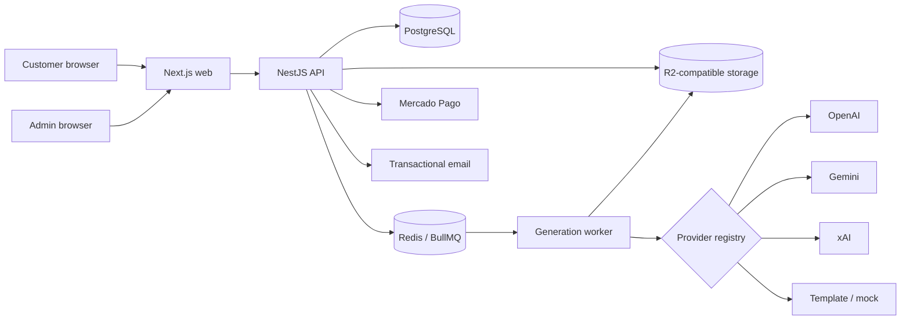

# Visagismo AI

Visagismo AI is a full-stack SaaS product that turns a guided questionnaire and customer photos into personalized image-analysis guidance and AI-assisted visual simulations. It covers the complete commercial flow: storefront, order recovery, payment, media upload, generation orchestration, delivery, administration, and data-subject requests.

> This repository is a curated portfolio snapshot. Production secrets, deployment manifests, operational runbooks, customer data, and private history are intentionally excluded. Any `.example` address is a non-routable placeholder.

## Engineering at a glance

- **17k+ lines** of TypeScript, TSX, and SQL across 132 source files
- **26 focused test cases** for state transitions, checkout guards, payment approval, and generation orchestration
- Next.js storefront and administration interface
- NestJS API and asynchronous worker in a pnpm/Turborepo monorepo
- PostgreSQL schema and migrations with Drizzle ORM
- Redis/BullMQ-ready job coordination
- Provider chain for OpenAI, Gemini, xAI, deterministic templates, and local image mocks
- Mercado Pago checkout and idempotent webhook processing
- Cloudflare R2-compatible media storage with local development fallback
- LGPD confirmation, export, deletion, and retention workflows

## Architecture



See [docs/ARCHITECTURE.md](docs/ARCHITECTURE.md) for component boundaries and design decisions.

## Technology

| Area | Technology |
| --- | --- |
| Web | Next.js 15, React 19, Tailwind CSS |
| API | NestJS 10, Zod, JOSE, Argon2 |
| Background work | Worker process, BullMQ-ready queue abstraction |
| Data | PostgreSQL 16, Drizzle ORM, Redis 7 |
| Media | Sharp, local storage, S3-compatible object storage |
| AI | OpenAI, Gemini, xAI, template and mock providers |
| Commerce | Mercado Pago Checkout Pro and webhooks |
| Tooling | TypeScript 5.7, pnpm workspaces, Turborepo, Node test runner |

## Product flow

1. A customer selects a package and starts an order.
2. A capability-scoped session protects questionnaire and photo operations.
3. Uploaded images are validated before local or object-storage persistence.
4. Checkout transitions the order through an explicit domain state machine.
5. Idempotent payment approval writes an outbox event for generation.
6. The provider registry runs analysis and image strategies with controlled fallback.
7. Results are persisted and delivered through the authenticated recovery flow.
8. Administration covers orders, packages, costs, provider status, and operational actions.

## Repository map

```text
apps/web/             public storefront, order flow, results, and admin UI
apps/api/             HTTP API, authentication, payments, storage, and LGPD
apps/worker/          background generation entry point
packages/domain/      pure state-machine and checkout rules
packages/generation/  analysis and image-provider orchestration
packages/db/          Drizzle schema, migrations, and seed catalog
packages/queue/       queue abstraction and job contracts
packages/shared/      shared schemas, status labels, and API types
docker/               generic application Dockerfiles
docs/                 portfolio-oriented architecture documentation
```

## Local development

Requirements: Node.js 20+, pnpm 9, and Docker.

```bash
corepack enable
pnpm install
cp .env.example .env
docker compose up -d
pnpm db:migrate
pnpm db:seed
pnpm dev
```

- Web: `http://localhost:3000`
- API health: `http://localhost:3001/v1/health`

The local configuration disables real payments and uses the deterministic mock provider unless API keys are explicitly supplied.

## Validation

```bash
pnpm test
pnpm typecheck
pnpm build
```

The public repository runs these checks in GitHub Actions.

## Project status

The private operational repository continues independently. This snapshot is intended for source review and engineering discussion, not as a hosted service or supported distribution.

## License

Source-available for portfolio evaluation. All rights are reserved; see [LICENSE](LICENSE).
